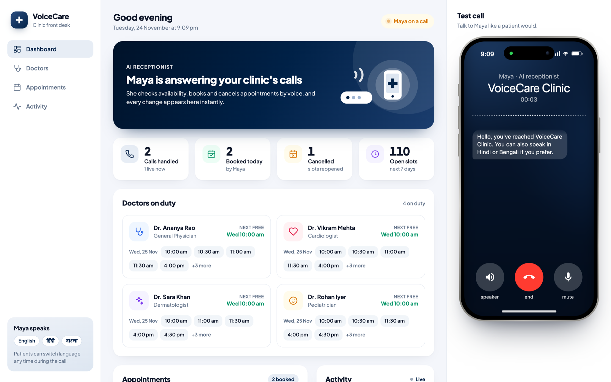
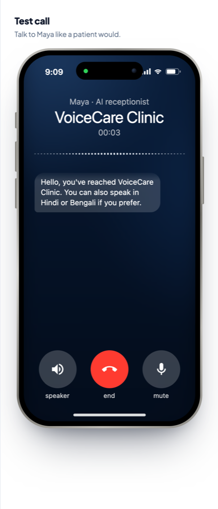
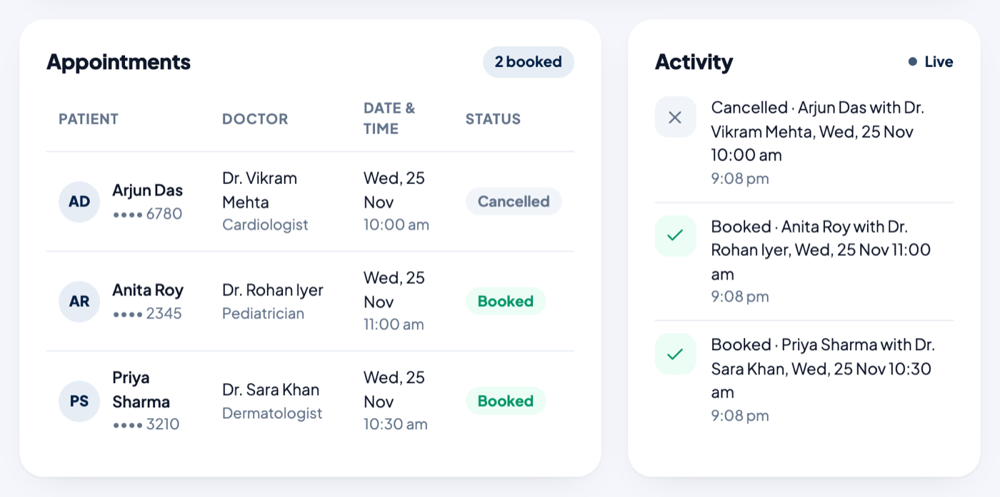

# VoiceCare — AI voice receptionist for a clinic

**Every unanswered call at a clinic is a patient who books somewhere else.** VoiceCare gives a clinic a receptionist that never puts anyone on hold: **Maya**, a real-time voice agent who checks doctors' availability, books appointments and cancels them in one natural phone-style conversation, while the clinic team watches every booking appear on a live dashboard.

**Python · Pipecat · Sarvam AI · ElevenLabs · WebRTC · SQLite** — speaks **English, हिंदी and বাংলা**

<!-- Demo video: add the link here once recorded -->



<table>
  <tr>
    <td width="34%" valign="top"></td>
    <td valign="top">
      
      <br><br>
      <b>Highlights</b>
      <ul>
        <li>Books, checks and cancels appointments in one voice conversation, using LLM tool calling</li>
        <li>Caller identified only by the phone number they say, read back digit by digit before acting</li>
        <li>~0.3&nbsp;s LLM response time with Sarvam <code>sarvam-105b-conversations</code></li>
        <li>Switches between English, Hindi and Bengali mid-call</li>
        <li>Live dashboard: stats, doctor schedules, appointments and activity update the moment Maya acts</li>
      </ul>
    </td>
  </tr>
</table>

<sub>Screenshots from a local run. Patients and bookings shown are sample data.</sub>

---

## Why a clinic needs this

At most small and mid-size clinics, one front-desk person answers the phone **and** handles patients at the counter. That creates the same problems every day:

| Problem at the front desk | What it costs the clinic |
|---|---|
| Calls go unanswered during rush hours, lunch breaks and after closing | Lost appointments; patients call the next clinic on their list |
| Staff spend much of the day on repetitive calls: "Is the doctor free tomorrow?", "Please cancel my slot" | Less time for the patients standing in front of them |
| Bookings scribbled on paper or typed in later | Double bookings, wrong times, slots left empty after cancellations |
| Cancelled slots are not reopened quickly | A doctor's time goes unused while other patients are told "no slots" |

### What Maya does for each side

**For the clinic and doctors**
- **Answers every call, instantly, at any hour.** No hold music, no missed calls, no extra staff shift.
- **Keeps the schedule accurate.** Maya only offers slots that are actually free in the system and cannot double-book; every booking and cancellation updates the schedule at once.
- **Reopens cancelled slots immediately**, so another patient can take them the same day.
- **Frees the front desk** to focus on patients in the clinic instead of the phone.
- **Gives full visibility.** The dashboard shows each conversation as it happens, today's open slots per doctor, and every booking and cancellation.

**For patients**
- Book or cancel in under a minute by simply talking, without apps, forms, logins or OTPs.
- **Talk in their own language** — English, Hindi, Bengali or Hinglish. Maya answers in the caller's language, so patients who aren't comfortable in English can still book on their own.
- Ask by doctor name **or** by need ("I need a skin doctor", "मुझे दिल के डॉक्टर से मिलना है"), and hear real available times.
- Their identity is their phone number, read back to them to avoid mistakes.

### Built for trust
- **No invented information.** Every slot Maya mentions comes from the clinic's schedule through a tool call, never from the AI's imagination.
- **Confirms before acting.** Maya reads the phone number back digit by digit and books or cancels only after the caller says yes.
- **Knows her limits.** She doesn't give medical advice or promise things the clinic can't do (like SMS reminders) — she says so politely.

### Where this can go next
This project is a working prototype with mock data. A production version for a real clinic would add:
- A **real phone number** (Pipecat supports telephony providers such as Twilio) so patients simply call the clinic
- **More Indian languages** — Hindi and Bengali work today; Tamil, Telugu, Marathi and others can be switched on in `CALLER_LANGUAGES` and need testing with native speakers
- **SMS / WhatsApp confirmations and reminders** to reduce no-shows
- **Integration with the clinic's existing appointment or EMR software** instead of the demo database
- **Multiple clinics and branches** from one dashboard

---

## What it does

Talk to Maya from the browser: she checks doctors' availability, books appointments and cancels them, all in one conversation. A live dashboard shows the call transcript, the doctors' open slots and the appointment ledger updating as Maya works.

The caller is identified **only by the phone number they say out loud**: no login, no OTP. Maya reads the number back digit by digit and acts only after the caller confirms it.

---

## How it works

```
 Browser mic ──WebRTC──▶ ElevenLabs STT ──▶ LLM (Sarvam) ──▶ ElevenLabs TTS ──WebRTC──▶ Browser speaker
                                               │
                                     function calling
                                               ▼
                         check_doctor_availability · book_appointment · cancel_appointment
                                               │
                                               ▼
                                         SQLite (clinic.db)
                                               │
                              RTVI server message ("booked" / "cancelled")
                                               ▼
                                   Dashboard refreshes instantly
```

Each call runs one [Pipecat](https://github.com/pipecat-ai/pipecat) pipeline:

| Stage | Service | Role |
|---|---|---|
| Transport | Pipecat `SmallWebRTCTransport` | Live audio between the browser and the Python server |
| Turn detection | Silero VAD + ElevenLabs VAD commits | Knows when the caller starts and stops talking; lets the caller interrupt Maya |
| Speech-to-text | ElevenLabs Realtime STT (`scribe_v2_realtime`) | English + Hindi + Bengali, with doctor names and specialties as key terms |
| LLM | **Sarvam** `sarvam-105b-conversations` | Holds the conversation and decides when to call tools |
| Text-to-speech | ElevenLabs (`eleven_v3`, voice "Bella") | Maya's voice, clear in English, Hindi and Bengali |
| Context | `LLMContext` + aggregators | Conversation memory: what was said and every tool result |

### Tools (LLM function calling)

| Tool | What it does |
|---|---|
| `check_doctor_availability(doctor?, date?)` | Free slots, filtered by doctor name **or** specialty ("Mehta", "cardiologist") and optional date |
| `book_appointment(doctor, starts_at, phone, patient_name?)` | Books a free slot; rejects invalid numbers, unknown slots and double bookings |
| `cancel_appointment(phone, appointment_id?)` | Cancels the caller's booking found by phone number; asks which one if there are several |

Business rules live in plain Python (`clinic.py`), so the LLM can't invent slots: every answer about availability comes from a tool result.

### Regional languages (English · Hindi · Bengali · Hinglish)
- **Hearing:** ElevenLabs STT runs with English as the primary language plus a short list of extra languages (`CALLER_LANGUAGES`, default `hi,bn`). A fixed list avoids the wrong-language guesses full auto-detection makes on short replies like "yes".
- **Thinking:** English is the default; Sarvam switches to Hindi or Bengali only when the caller does, writing each in its own script (Devanagari, Bengali) so the voice pronounces it naturally, but always passes **tool arguments in English** (specialty names, ISO dates, plain digits).
- **Understanding everyday words:** "skin doctor", "दिल का डॉक्टर", "bachche ka doctor", "বাচ্চার ডাক্তার" are mapped to the right specialty, and phone numbers transcribed in Hindi or Bengali digits (९८७६…, ৯৮৭৬…) are normalized to 0–9.
- **Speaking:** the ElevenLabs multilingual voice reads Hindi and Bengali directly, including the phone number read-back digit by digit. In Indian languages Maya writes numbers, dates and times as words ("সকাল দশটা", not "10:00 AM"), which the voice pronounces far more clearly.

### Why `eleven_v3` for the voice
Patients speaking Hindi or Bengali need to understand Maya the first time, especially dates, times and their phone number. To compare voice models objectively, the same Bengali reply was synthesized with each model and transcribed back with ElevenLabs speech-to-text:

| Voice model | Bengali sentence recovered | Time to first audio | Streaming |
|---|---|---|---|
| `eleven_flash_v2_5` | 85% | ~0.2 s | WebSocket |
| **`eleven_v3`** | **100%** | ~0.7 s | HTTP |

`eleven_v3` costs about half a second per reply, but it recovered the full sentence in this test and sounded clear in live Hindi and Bengali calls, so it is the default. For English-only or credit-limited use, switch to `eleven_flash_v2_5` with one line in `.env`.

### Why Sarvam for the LLM
The brief recommends Gemini for its free quota. While building, the free Gemini tier was returning 7–14 s replies and "503 high demand" errors, which is unusable for voice. Sarvam's `sarvam-105b-conversations` answers in **~0.2–0.3 s** with reliable tool calling and has free signup credits. Gemini is still supported: set `LLM_PROVIDER=google`.

---

## Dashboard

- **iPhone test call** — titanium frame, Dynamic Island, iOS lock screen and iOS call screen (calling → connected → ended), ringtone, timer, speaker / mute / end
- **Live transcript** inside the phone, plus a voice waveform driven by mic and bot audio levels
- **Booking confirmation card** that pops up in the phone when Maya books or cancels
- **Live stats** — calls handled (and live now), booked and cancelled today, open slots for the week
- **Doctors on duty** — specialty icon, next free slot and that day's open times
- **Appointments ledger** — updates instantly after a booking or cancellation (new rows flash)
- **Activity feed** — calls answered, bookings and cancellations as they happen; a "Maya on a call" status in the header
- Responsive layout: sidebar collapses on laptops, single column on mobile

Plain HTML/CSS/JS, no build step. The Pipecat browser client is loaded from a CDN.

---

## Run it locally

**Requirements:** Python 3.10+, a microphone, Chrome (or any modern browser).

```bash
git clone <this-repo>
cd voicecare-agent
python3 -m venv .venv
.venv/bin/pip install -r requirements.txt
cp .env.example .env      # then add your keys
.venv/bin/python bot.py
```

Open **http://localhost:7860**, click the green call button and allow the microphone. Headphones give the best results.

### Environment variables (`.env`)

| Variable | Required | Notes |
|---|---|---|
| `ELEVENLABS_API_KEY` | yes | Needs Text to Speech, Speech to Text, Voices (read), Models access |
| `ELEVENLABS_VOICE_ID` | no | Default: Bella. **Free ElevenLabs plans must use a "premade" voice** — library voices fail via the API |
| `ELEVENLABS_TTS_MODEL` | no | `eleven_v3` (default, clearest Hindi/Bengali, ~0.7 s to first audio) or `eleven_flash_v2_5` (fastest, ~0.2 s, uses fewer credits) |
| `CALLER_LANGUAGES` | no | Extra languages besides English, ISO codes, comma-separated. Default `hi,bn` (Hindi, Bengali) |
| `LLM_PROVIDER` | no | `sarvam` (default) or `google` |
| `SARVAM_API_KEY` | if Sarvam | From [dashboard.sarvam.ai](https://dashboard.sarvam.ai) |
| `SARVAM_MODEL` | no | Default: `sarvam-105b-conversations` |
| `GOOGLE_API_KEY` | if Google | From Google AI Studio |
| `GEMINI_MODEL` | no | Default: `gemini-3.5-flash-lite` |

Keys are never committed: `.env` is in `.gitignore`.

### Try this conversation
1. *"I'd like to see a cardiologist."*
2. Pick one of the times Maya offers.
3. Give your name and a 10-digit phone number, then confirm when she reads it back → the booking appears on the dashboard.
4. Call again: *"I want to cancel my appointment"* → give the same number → the row changes to **cancelled** and the slot reopens.
5. Try it in Hindi: *"नमस्ते, मुझे स्किन डॉक्टर से मिलना है"* or Bengali: *"নমস্কার, আমার বাচ্চার জন্য ডাক্তার দেখাতে চাই"* — Maya continues in that language.

---

## Project structure

```
bot.py            Pipecat pipeline, system prompt, tool schemas + handlers, dashboard API routes
clinic.py         SQLite data layer: doctors, slots, appointments, phone normalization
frontend/
  index.html      Layout: phone + schedule + ledger
  style.css       Design
  app.js          Pipecat client, call states, transcript, waveform, live dashboard updates
requirements.txt  Pinned dependencies
.env.example      Configuration template
```

`clinic.db` is created on first run and filled with 4 mock doctors and the next 7 days of weekday slots. Run `python clinic.py` to reset it and self-test the booking logic.

---

## Notes and limitations

- Mock data only; doctors and slots are generated, not a real clinic system.
- One clinic schedule shared by all callers; there is no authentication beyond the spoken phone number, as required by the brief.
- The server log shows each tool call and each browser event (`/api/client-log`), which makes debugging live calls easy.
- On macOS with Python from python.org, HTTPS certificates are loaded from `certifi` automatically (`bot.py` sets `SSL_CERT_FILE`).
